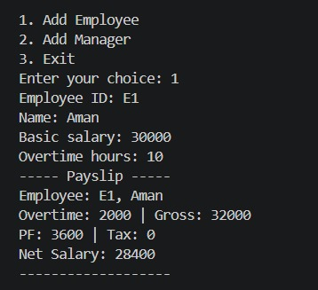
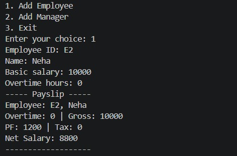
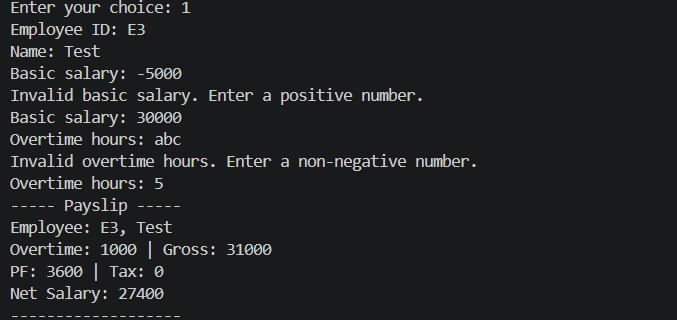
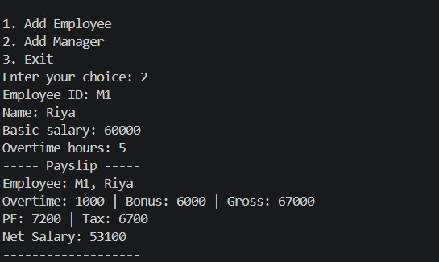

# Summary: Employee Payroll System (PS 45)

## 1. Project Statement

The PS asks for a payroll program that calculates the net salary of employees and managers. Pay is worked out from basic salary, overtime and bonus, with PF and tax taken off. Each payslip must be saved to a file.

The main requirements are:

- Written in Python 3, as one `.py` file(employee_payroll.py), run from the console.
- A class `Employee` with id, name, basic salary and overtime hours.
- A class `Manager` that inherits from `Employee` and adds a 10% bonus on basic pay.
- Overtime is Rs.200 per hour.
- Gross = basic + overtime + bonus. PF = 12% of basic. Tax = 10% of gross if gross is above Rs.50,000, otherwise 0.
- Net = gross − PF − tax.
- Input must be validated, the program must keep asking until the input is valid, and each payslip is saved to `payroll.txt`.
- Concepts: functions, calculations, OOP and file handling.

## 2. Implementation

The program is built around two classes and a small set of helper functions.

| Part | What it does |
|------|--------------|
| `Employee` class | Stores the data and calculates overtime, bonus (0 here), gross, PF, tax and net. Also builds the payslip text. |
| `Manager` class | Inherits from `Employee`. Overrides `calculate_bonus()` to return 10% of basic, and overrides `earnings_line()` so the bonus shows on the payslip. |
| `show_number()` | Prints whole numbers without decimals, and keeps two decimals when needed. |
| `read_name()`, `read_basic()`, `read_overtime_hours()` | Keep asking until the value is valid. Each one prints its own error message. |
| `save_payslip()` | Appends the payslip to `payroll.txt`. |
| `main()` | Shows the menu, reads the input, creates the right object, prints the payslip and saves it. |

### Why Manager inherits from Employee

Most of the pay logic is the same for both types of staff: overtime, gross, PF, tax and net. Writing it once in `Employee` means `Manager` only needs to change the parts that differ. The bonus is 0 in `Employee` and 10% of basic in `Manager`, and every other calculation is inherited without copying code.

### Calculating the payslip

Each method does one calculation, and the others call it. For example, `calculate_net()` calls `calculate_gross()`, `calculate_pf()` and `calculate_tax()`. This keeps each rule in one place, so changing the PF rate means changing one constant at the top of the file.

### Input validation

Each input has its own function with a `while True` loop. If the value is wrong, the function prints an error and asks again. The basic salary must be above 0, and the overtime hours must be 0 or more. The program converts the text with `float()` inside a `try` block, so letters such as `abc` are caught and rejected rather than crashing the program.

### Saving payslips

`save_payslip()` opens `payroll.txt` in append mode (`"a"`). Each new payslip is added to the end of the file, so the file keeps a record of every run.

## 3. Test Cases

Each test case was run from the menu. Screenshots are in the `screenshots` folder.

### Test Case 1: Normal input (Employee)

Input: ID `E1`, name `Aman`, basic `30000`, overtime `10`.

Expected: Overtime 2000, Gross 32000, PF 3600, Tax 0, Net 28400.

By hand: overtime 10 × 200 = 2000. Gross = 30000 + 2000 = 32000. PF = 12% of 30000 = 3600. Gross is not above 50000, so tax is 0. Net = 32000 − 3600 = 28400.

### Test Case 2: Boundary input (Employee)

Input: ID `E2`, name `Neha`, basic `10000`, overtime `0`.

Expected: Overtime 0, Gross 10000, PF 1200, Tax 0, Net 8800.

By hand: no overtime, so gross = 10000. PF = 1200. Tax 0. Net = 10000 − 1200 = 8800.

### Test Case 3: Invalid input

Input: ID `E3`, name `Test`. Basic `-5000`, then `30000`. Overtime `abc`, then `5`.

Expected: `Invalid basic salary. Enter a positive number.` and `Invalid overtime hours. Enter a non-negative number.` The program then continues with the valid values and prints a payslip with Overtime 1000, Gross 31000, PF 3600, Tax 0, Net 27400.

The two error messages are the test. The payslip afterwards shows the program recovered from the bad input and finished the job. The whole run is captured in the screenshot.

### Test Case 4: Different valid scenario (Manager)

Input: ID `M1`, name `Riya`, basic `60000`, overtime `5`.

Expected: Overtime 1000, Bonus 6000, Gross 67000, PF 7200, Tax 6700, Net 53100.

By hand: overtime 5 × 200 = 1000. Bonus = 10% of 60000 = 6000. Gross = 60000 + 1000 + 6000 = 67000. PF = 12% of 60000 = 7200. Gross is above 50000, so tax = 10% of 67000 = 6700. Net = 67000 − 7200 − 6700 = 53100.

## 4. Conclusion

The program meets the PS 45 requirements. It uses two classes with inheritance, calculates each part of the payslip, validates the input, and saves every payslip to a file. All four test cases give the expected output.

The main lesson was how inheritance removes repeated code. Because `Manager` reuses everything in `Employee` and changes only the bonus, adding a new type of staff later would take very little code.

## 5. Challenges Faced

- **Matching the number format.** Python prints `2000.0` by default, but the PS shows `2000`. The `show_number()` helper rounds the value and removes the `.0` when the number is whole, while keeping two decimals when needed.
- **Tax on the Manager.** The tax rule uses the gross, and the gross includes the bonus. It was easy to calculate tax from basic pay by mistake, which would have given the wrong net salary for Test Case 4.
- **Validation without crashing.** Entering text such as `abc` in a number field raised an error at first. Wrapping the conversion in `try` and re-asking the question fixed it.
- **Old payslips in the file.** Because payslips are appended, `payroll.txt` kept results from earlier runs. Deleting the file before each full test run kept the records clean.